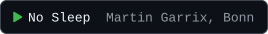
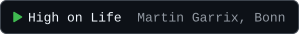
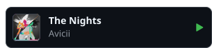
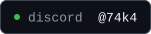
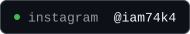

<!-- the board is one SVG, so GitHub has no layout of its own to get wrong:
     the cards keep their positions and sizes at every width.
     flat, and drawn on GitHub's own page background in both themes:
       dark   #0d1117 bg / #3d444d border / #f0f6fc ink / #3fb950 accent
       light  #ffffff bg / #d1d9e0 border / #1f2328 ink / #1a7f37 accent
     (Primer tokens, the contribution-graph greens included; <picture> picks
      the file for the viewer's GitHub theme.)
     board:     python scripts/fetch_commit_activity.py
                && python scripts/make_dashboard_svg.py   (daily via Actions;
                writes profile.svg and profile-light.svg)
     on repeat: list tracks in data/music.json, then
                python scripts/fetch_music_art.py         (covers -> assets/music/;
                by hand, not in CI). with no tracks the card falls back to
     portrait:  python scripts/make_ascii_svg.py          (taka-ascii.svg)
     wordmark:  python scripts/make_wordmark_svg.py --mode rock
     links:     python scripts/make_links_svg.py   -- separate files on purpose:
                an SVG behind  cannot carry clickable areas, so only these
                tiles can be wrapped in a link. one per on-repeat track (Apple
                Music) and per contact, sized in percent so the grid scales with
                the board (hence width="100%" on it); the script rewrites the
                lines between the links markers. run it after fetch_music_art.py.
     portrait and wordmark need Pillow + numpy:
                pip install -r scripts/requirements.txt
     the earlier stacked panels (heatmap / stats / stack) still build from
     their own scripts in scripts/. -->

<picture>
  <source media="(prefers-color-scheme: dark)" srcset="./profile.svg">
  <source media="(prefers-color-scheme: light)" srcset="./profile-light.svg">
  
</picture>

<!-- links:start -->
<a href="https://music.apple.com/us/album/no-sleep-feat-bonn/1453438469?i=1453438470"><picture><source media="(prefers-color-scheme: dark)" srcset="./assets/music/1453438470-link.svg"><source media="(prefers-color-scheme: light)" srcset="./assets/music/1453438470-link-light.svg"></picture></a><a href="https://music.apple.com/us/album/high-on-life-feat-bonn/1416740613?i=1416740913"><picture><source media="(prefers-color-scheme: dark)" srcset="./assets/music/1416740913-link.svg"><source media="(prefers-color-scheme: light)" srcset="./assets/music/1416740913-link-light.svg"></picture></a><a href="https://music.apple.com/us/album/the-nights/1440829274?i=1440829549"><picture><source media="(prefers-color-scheme: dark)" srcset="./assets/music/1440829549-link.svg"><source media="(prefers-color-scheme: light)" srcset="./assets/music/1440829549-link-light.svg"></picture></a> <a href="mailto:iam74k4@gmail.com"><picture><source media="(prefers-color-scheme: dark)" srcset="./links-mail.svg"><source media="(prefers-color-scheme: light)" srcset="./links-mail-light.svg"></picture></a><a href="https://discord.com/users/569686218632331264"><picture><source media="(prefers-color-scheme: dark)" srcset="./links-discord.svg"><source media="(prefers-color-scheme: light)" srcset="./links-discord-light.svg"></picture></a><a href="https://www.instagram.com/iam74k4"><picture><source media="(prefers-color-scheme: dark)" srcset="./links-instagram.svg"><source media="(prefers-color-scheme: light)" srcset="./links-instagram-light.svg"></picture></a>
<!-- links:end -->

